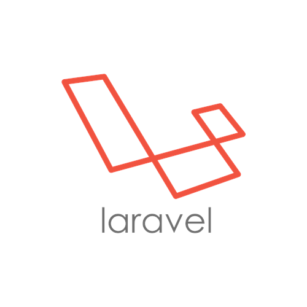
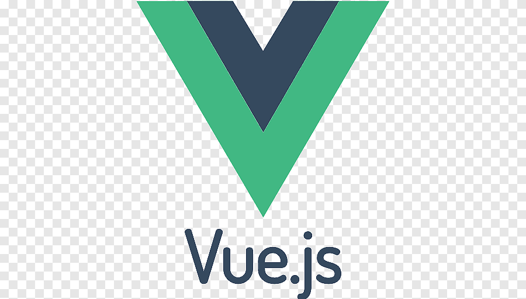

## Hai Devs :wave: 

<!--

  
     -->
  <samp>
    I graduated from the Politeknik Negeri Samarinda with a major in Technology Information in Samarinda, East Kalimantan, Indonesia. 
Currently works as a Web Developer, and I'm an expert on Laravel and other technologies such as:  
Front-End | Vue, Pinia, Vuex, TypeScript, Tailwind, Bootstrap 5  
Back-end | Laravel, MySql  
Mobile | Flutter
  </samp>

### Tools used  :rocket:
 
 
              

## My Github Performance

## My medium

Daftar lengkap artikel + thumbnail: [MEDIUM.md](MEDIUM.md).

